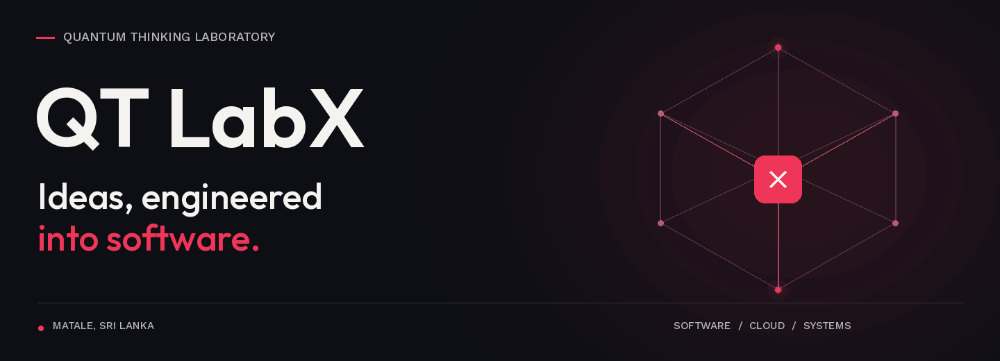

<a href="https://qtlabx.com">
  <picture>
    <source media="(prefers-reduced-motion: reduce)" srcset="./assets/qtlabx-banner.png">
    
  </picture>
</a>

# Software that moves real work forward.

Custom software. Cloud solutions. Connected systems.

  
  &nbsp;
  
  &nbsp;
  

---

### The thinking behind the build

**QT LabX**, a brand of **Quantum Thinking Laboratory**, is a software team based in **Matale, Sri Lanka**. We turn business requirements into useful digital products, bringing software engineering, cloud infrastructure and connected security together.

We build for the people behind everyday work: school administrators, workshop teams, creators and learners.

[Get to know our team →](https://qtlabx.com/about)

### What we build

- **Custom software** — Applications shaped around your workflows, users and business needs.
- **Cloud solutions** — Cloud services alongside our software engineering practice.
- **Connected security** — Security technology integrated into a broader view of your systems.

[Explore our services →](https://qtlabx.com/services)

### Technology partnerships

- **[Google Cloud Partner](https://cloud.google.com/find-a-partner/partner/qt-labx)** — Cloud and AI solutions.
- **[Hikvision](https://www.hikvision.com/en/)** — Connected security technology partnership.

### Products with a purpose

**01 / EDUCATION · [CSM System](https://qtlabx.com/solutions/school-management)**  
School administration, academics, staff workflows, fees and communication in one workspace, with web and Android experiences.

**02 / AUTOMOTIVE · [Auto](https://auto.qtlabx.com)**  
Software for service stations, with workshop workflows and a dedicated experience for vehicle owners.

**03 / CREATIVE TOOLS · [Jiyara](https://jiyara-studio.web.app)**  
An AI-assisted workspace for creating and refining marketing visuals, product imagery and social content.

**04 / WEB LEARNING · [TiKi](https://chromewebstore.google.com/detail/tiki/jgapjnphcimmmnpipcpajojnpcfcpmdp?hl=en)**  
A browser learning companion that explains selected text, supports language choice and answers follow-up questions.

**05 / ACADEMIC MARKETPLACE · [FinalPitch](https://finalpitch.qtlabx.com) · Preview**  
Discover and list academic projects, with campus-based visibility and project downloads.

### Build a conversation

Join us on **[Discord](https://discord.gg/RPUuhfDFf)** to connect with the QT LabX community. For project enquiries, product demos and business conversations, reach our team by email.

Exploring a public repository? Start with its README and contribution guidance. Report reproducible bugs through its issue tracker where available. For sensitive reports, contact us privately by email.

---

### Your next project starts here

- **Website:** [qtlabx.com](https://qtlabx.com)
- **Email:** [contact@qtlabx.com](mailto:contact@qtlabx.com)
- **Phone:** [+94 77 00 235 66](tel:+94770023566) · [+94 77 68 000 67](tel:+94776800067)
- **Location:** Winrose Garden, Matale, Sri Lanka
- **Discord:** [Join the community](https://discord.gg/RPUuhfDFf)

[Discuss a project →](mailto:contact@qtlabx.com?subject=Project%20enquiry%20%E2%80%94%20QT%20LabX) &nbsp; · &nbsp; [Request a CSM demo →](mailto:contact@qtlabx.com?subject=CSM%20System%20demo%20request)

  <strong>QT LabX</strong> · Quantum Thinking Laboratory · Matale, Sri Lanka 
  Thoughtful engineering. Useful software.

